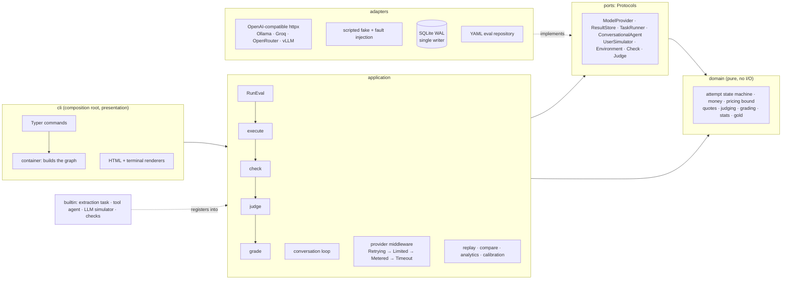
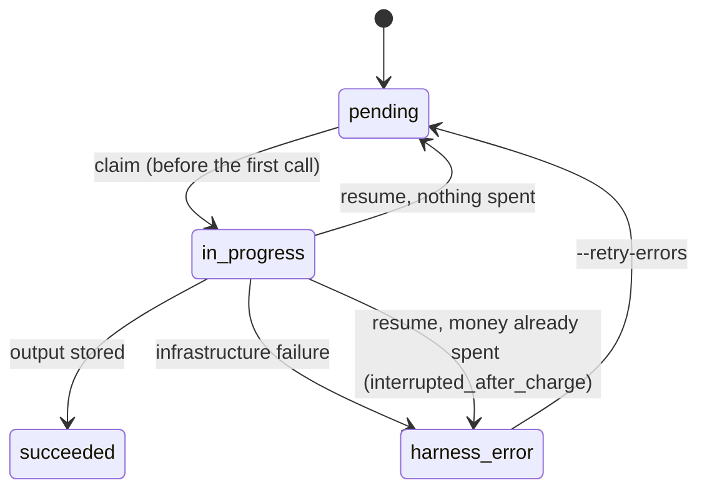

# Assayer

**Durable, budget-guarded evals for LLM tasks and tool-using agents.**

[](https://github.com/bernardosaab/assayer/actions/workflows/ci.yml)
[](https://bernardosaab.github.io/assayer/)


Assayer is one harness for two very different kinds of evaluation:

* **single-step LLM tasks**: a document goes in, structured facts come out (résumé or job-posting extraction);
* **conversational agents**: dozens of turns, their own tool choices, a simulated user on the other side.

They share one framework (fixtures, graders, a results store, a cost guard), so a new eval adds only what is
unique to it. A new scenario is one YAML file; a new criterion is one check or one rubric line.

The model is the smaller part of an agent. Most failures are harness failures: no step cap, a judge nobody
checked, a crash that silently re-spends money, a "pass rate" that counts infrastructure outages as agent
failures. Assayer is about that harness, and it is built to be **safe to re-run**, **cheap to extend**, and
**observable**, so that evals work as a loop you climb rather than a gate you pass once.

> Everything runs free: offline against a deterministic scripted provider (what CI uses), or locally against
> [Ollama](https://ollama.com). Any OpenAI-compatible endpoint works through one small adapter.

---

## Quickstart (offline, about 30 seconds)

```bash
git clone https://github.com/bernardosaab/assayer && cd assayer
uv sync
uv run assayer run resume_extraction --run-id demo
uv run assayer report demo            # writes reports/demo.html
```

```text
Started run demo  (resume_extraction, fake/agent)
  executed 6 attempt(s): 6 ok, 0 harness errors
  scored: 24 new check results, 6 judgements (0 reused, 0 judge errors)
 pass rate          66.7%  (95% CI 30.0%-90.3%, n=6)
 outcomes           4 pass / 2 fail / 0 harness error
 cost per success   $0.0014
 judge              6 judgements, 1 re-asks, 1/2 findings dropped (unverified quote)
     failure causes (error analysis)
 check:field_match  2 | check:trap_absent 1 | judge:current_role 1 | agent 1 | check:set_f1 1
```

The scripted model is **deliberately imperfect** so the demo exercises real failure paths. It reports a
career changer's *previous* employer as current (a trap value in the gold label), answers in prose instead of
JSON once, and the scripted judge contradicts itself once and cites a fabricated quote once. Run it again with
the same `--run-id` and nothing is re-executed: `executed 0 attempt(s)`.

The [demo site](https://bernardosaab.github.io/assayer/) has the HTML reports for all three evals, rebuilt by CI on
every push.

### With a real local model (free)

```bash
ollama pull llama3.2:3b && ollama pull qwen2.5:7b   # agent and judge from different families
uv run assayer providers --profile ollama           # checks the endpoints and models
uv run assayer run hr_assistant --profile ollama --repeats 3
```

---

## What it does

| | |
|---|---|
| **Durable runs** | One SQLite file is the record. Each attempt `(run, case, repeat)` is claimed *before* its first model call and finished when it returns. A crashed or interrupted run resumes where it stopped; finished work is never redone. |
| **Cost guard** | Every metered call reserves its **worst-case** cost in a transaction *before* the request leaves, settles the real cost after, and is refused if it would exceed the run's budget. A crash cannot lose track of spend. |
| **Three outcomes** | `pass`, `fail`, `harness_error`. Harness errors (provider down, timeout, locked store) are excluded from every rate and re-run; an agent that returns bad JSON or loops on tools is a `fail`. |
| **Sensors first** | Deterministic checks settle what code can: field matches against two-labeller gold, trap values, grounding in the source, tool calls, **end state of the system of record**. |
| **A judge that is checked** | The LLM judge reasons before its verdict, is re-asked once if it contradicts itself, and every violation must quote the evidence **verbatim**. Unverifiable findings are dropped, and the final verdict comes from what survives. |
| **Agents and simulated users** | Conversation fixtures are a **persona** (who the user is) plus a **scenario** (goal, kind: ordinary / edge / pressure, expectations). The simulator never sees the expectations. Stop conditions live in code. |
| **Trajectory scoring** | Tool selection, argument correctness, order-aware step score, efficiency budget, end state, false-success claims after a failed write, and leaks of data the user may not see. |
| **Replay** | Re-score stored outputs with the current graders and **zero calls to the agent**, so a change in grading is told apart from a change in the agent. |
| **Statistics that admit their sample size** | Wilson intervals, pass^k and pass@k across repeats, a **paired** McNemar test between runs, the smallest change a run can resolve, and the flipped cases themselves. |
| **Judge calibration** | Blind, verdict-stratified samples for people to label; TPR/TNR, Cohen's kappa, and a pass rate corrected for the judge's measured error. |
| **Observability** | Each run records git sha, and content hashes of the prompt, rubric and graders. Static HTML reports, published to GitHub Pages by CI. |

### The three example evals

| Eval | Kind | What it shows |
|---|---|---|
| [`resume_extraction`](evals/resume_extraction) | task | Gold labels with labeller votes, a tiebreak, and **trap** values; four deterministic checks plus a quoting judge. |
| [`posting_extraction`](evals/posting_extraction) | task | A second eval with **zero Python**: the same runner and checks, new YAML. |
| [`hr_assistant`](evals/hr_assistant) | conversation | A tool-using HR agent over an in-memory system of record: 4 personas, 8 scenarios including a **chaos** case (the write tool times out; the agent must not claim success) and a **prompt-injection** case (a policy document carries planted instructions). |

---

## Architecture

Ports and adapters, with a pure domain. The layering is enforced by a test, not by convention
([`tests/architecture/test_layering.py`](tests/architecture/test_layering.py)).



One metered call, end to end:

```mermaid
sequenceDiagram
  participant SUT as Agent / judge
  participant M as MeteredProvider
  participant L as Ledger (SQLite)
  participant P as Provider
  SUT->>M: complete(request)
  M->>M: worst case = prompt bytes × in-price + max_tokens × out-price
  M->>L: BEGIN IMMEDIATE; committed + worst ≤ budget? INSERT reserved
  alt over budget
    L-->>M: BudgetExceeded (no request is sent)
  else reserved
    M->>P: request
    P-->>M: response + usage
    M->>L: settle(actual)   (never sent → release; maybe billed → keep worst case)
  end
```

Attempt lifecycle ([`domain/attempt.py`](src/assayer/domain/attempt.py)):



Every decision a reasonable engineer could make differently has an
**[Architecture Decision Record](docs/adr/)** with its trade-offs: why SQLite, why the cost bound
over-reserves, why a crashed paid attempt is surfaced instead of retried, why the judge's own verdict is
overridden by its verified findings, why one HTTP adapter instead of vendor SDKs, and so on.

---

## The loop: run, read failures, fix, run again

```bash
uv run assayer run hr_assistant --run-id v1 --repeats 3
uv run assayer failures v1                 # failing attempts with the reason each failed
uv run assayer summary v1                  # failure causes counted: start error analysis here
# ... fix the agent's prompt or tools ...
uv run assayer run hr_assistant --run-id v2 --repeats 3
uv run assayer diff v1 v2 --fail-on-drop 0.05 --html reports/v1-v2.html   # exit 1 on regression
```

If a number moved, find out whether the agent changed or the grading did:

```bash
uv run assayer replay v1 --into v1-regraded   # same outputs, current graders, zero agent calls
uv run assayer diff v1 v1-regraded
```

The fix can land on either side: a prompt rule, a tool change or a data fix for the agent; a sharper check,
a new scenario or a relabelled gold value for the harness. A failure found in production becomes a scenario
file and stays as a permanent guard. See [docs/hill-climbing.md](docs/hill-climbing.md).

### Adding an eval

* **A scenario**: one YAML file in `evals/<name>/scenarios/` plus a fixture pairing it with a persona.
* **A criterion**: one check entry (`- use: tool_not_called`) or one rubric line for the judge.
* **A task**: an `eval.yaml` with a prompt and an output schema; the built-in extraction runner does the rest.
* **A check**: a class with `evaluate(case, output) -> CheckResult`, registered by name.

`uv run assayer validate <eval>` catches unresolved gold labels, traps equal to the expected value, unknown
or duplicate checks, and missing sections before anything is spent.

---

## Command reference

| Command | Purpose |
|---|---|
| `run EVAL [--profile] [--run-id] [--repeats] [--budget-usd] [--retry-errors] [--min-pass-rate]` | Execute and score; the same run id resumes. Exit 3 if halted (budget or circuit breaker). |
| `score RUN` | Re-run only the missing scoring work. |
| `summary RUN` / `failures RUN` / `runs` / `budget RUN` | Rates and causes / the hill-climbing view / list runs / the cost ledger. |
| `report RUN` | Static HTML report. |
| `replay RUN --into NEW [--rejudge]` | Re-score stored outputs with the current graders. |
| `diff BASE CAND [--fail-on-drop X] [--html]` | Paired comparison; exit 1 on regression (a release gate). |
| `calibrate sample/import/stats` | Judge calibration against people. |
| `validate EVAL` | Static checks on an eval definition. |
| `providers [--profile]` | Check that endpoints answer and serve the configured models. |

---

## Testing

```bash
uv run pytest                 # ~250 tests, no network; coverage gate 90%
uv run pytest -m live         # contract tests against a local Ollama (skipped if not running)
uv run ruff check . && uv run mypy
```

* **Property tests** (Hypothesis): quote normalization, and a **stateful** model of the cost ledger
  (reserve / settle / release / crash-and-recover in any order) that keeps the invariant
  *committed ≤ budget* against the real SQLite store. Hypothesis found a real edge case in quote
  verification along the way (`"ı".upper()` is not undone by `casefold()`), documented in ADR-0011.
* **Concurrency**: 200 concurrent reservations, and two OS processes sharing one budget, never overspend.
* **Crash test**: the real CLI is killed with `os._exit` mid-call (like `kill -9`), then resumed; finished
  work is kept, the in-flight paid attempt is surfaced, its orphaned reservation still counts.
* **Contract tests**: the scripted fake and the HTTP adapter (against recorded responses) pass the same suite.
* **Golden files**: HTML reports are compared byte for byte (this caught a hash-randomized ordering bug).
* **Architecture test**: the domain imports no I/O, and no layer imports an outer one.
* CI runs on Ubuntu and Windows, Python 3.12 and 3.13, then runs every eval offline with pass-rate gates and a
  replay-plus-diff release gate.

---

## Honest limitations

* **Single machine.** SQLite with one writer thread is the right size for an eval harness on a laptop or a CI
  runner, not for a shared multi-tenant service. Swapping in PostgreSQL means one new adapter; the ports
  are already split for it.
* **A crashed conversation is redone from the start.** The unit of durability is the attempt, not the turn.
* **The cost bound over-reserves** (about 3-4x on English) because it counts bytes, not tokens. That buys
  a guarantee without shipping a tokenizer per model family.
* **Small samples.** The example evals have 3-8 cases; the reports say so (the diff prints the smallest
  change the sample can resolve). Real decisions need more cases, or paired designs with repeats.
* **Offline numbers are not model quality.** The scripted provider tests the harness, not any model.
* **Gold labelling is YAML reviewed in pull requests**, not a labelling UI.

## Project layout

```
src/assayer/
  domain/        pure rules: attempt state machine, money, pricing bound, quotes, judging, grading, stats, gold
  ports/         Protocols the application depends on
  application/   use cases: run, execute, score, judge, conversation loop, replay, compare, calibration
  adapters/      SQLite store, OpenAI-compatible HTTP, scripted fake, YAML loader, price table, git
  builtin/       reusable runners, the reference tool agent, the user simulator, checks
  cli/           composition root, commands, terminal and HTML rendering
evals/           the three example evals
docs/adr/        architecture decision records
tests/           unit, property, contract, integration, e2e, architecture, golden
```

Inspired by Vela Gao's essay on building one eval harness for many LLM tasks and agents; this is an
independent implementation. MIT licensed.
