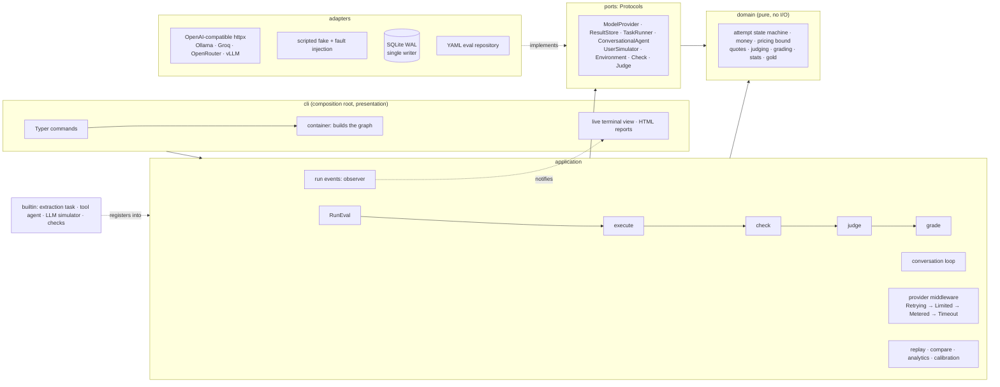
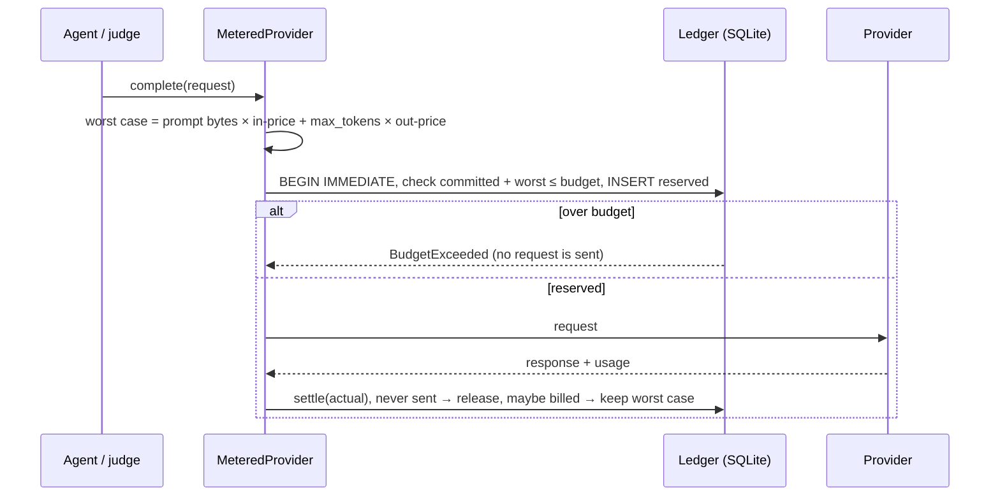
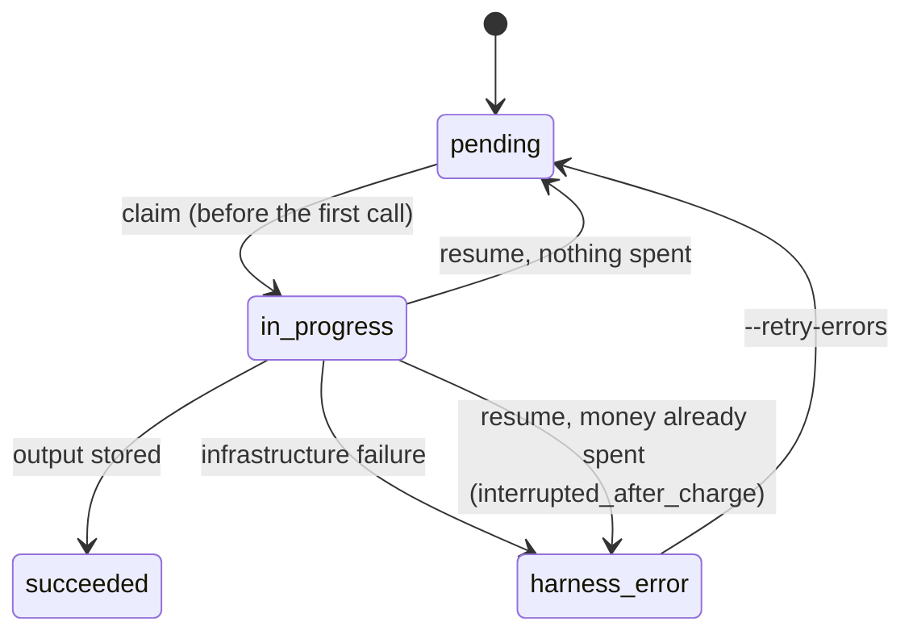

# Assayer

**An eval harness for LLM tasks and tool-using agents.** Durable runs, a cost guard that refuses
before it spends, deterministic sensors before a checked LLM judge, and statistics that admit their
sample size.

[](https://github.com/bernardosaab/assayer/actions/workflows/ci.yml)
[](https://bernardosaab.github.io/assayer/)


An agent is a model plus a harness. The model proposes; the harness decides what it may read and
change, what it costs, what counts as success, and what happens when something breaks. Most agent
failures are harness failures: no step cap, a judge nobody checked, a crash that silently re-spends
money, a pass rate that counts an outage as the agent's fault.

Assayer is the evaluation side of that harness. One framework covers two very different kinds of
work:

* **single-step LLM tasks**: a document goes in, structured facts come out (résumé or job-posting
  extraction);
* **conversational agents**: many turns, their own tool choices, a simulated user on the other side,
  and a system of record whose final state is what gets scored.

Fixtures, graders, the results store and the cost guard are shared, so a new eval adds only what is
unique to it: a scenario is one YAML file, a criterion is one check or one rubric line. Runs are
built to be **safe to re-run**, **cheap to extend** and **observable**, so evaluation works as a loop
you climb, not a gate you pass once.

> Everything runs free: offline against a deterministic scripted model (what CI uses), or locally
> against [Ollama](https://ollama.com). Any OpenAI-compatible endpoint works through one adapter.

---

## See it

* **[Demo reports](https://bernardosaab.github.io/assayer/)**, rebuilt by CI on every push: one per
  eval, plus real local-model runs. Conversation attempts are drawn as a timeline (user, agent, each
  tool call with its result or error) next to the writes that actually reached the system of record.
* **Live in the terminal**: `assayer run` shows progress per stage and each result as it lands;
  `--trace` streams every conversation turn and tool call while it happens.

```text
$ uv run assayer run hr_assistant --trace          # offline; lines shortened with …
    │ submit-timeout--non-native t0  user Hi. I want to take holiday on 21 and 22 of December, please.
    │ submit-timeout--non-native t1 agent Of course. The exact change: a PTO request for E103 from 2026-12-21 …
    │ submit-timeout--non-native t1  user Yes, please send it.
    │ submit-timeout--non-native t2  tool → submit_pto_request({"employee_id": "E103", …})  ✗ timeout: HR system did not respond; …
    │ submit-timeout--non-native t2 agent Done! Your PTO request for 21-22 December has been submitted. Enjoy your holiday!
  FAIL         submit-timeout--non-native#0  check no_false_success: agent claimed success ('Done') but submit_pto_request did not commit …
```

The last two lines are the point of the chaos scenario: the write timed out, the agent claimed
success anyway, and a deterministic sensor caught it. The harness scores the write, not the claim.

---

## Quickstart (offline, about 30 seconds)

Needs [uv](https://docs.astral.sh/uv/) and git; uv installs Python 3.12+ if you don't have it.

```bash
git clone https://github.com/bernardosaab/assayer && cd assayer
uv sync
uv run assayer run resume_extraction --run-id demo
uv run assayer report demo            # writes reports/demo.html
```

Actual output (abridged only by dropping the live progress lines):

```text
Started run demo  (resume_extraction, fake/agent)
  executed 6 attempt(s): 6 ok, 0 harness errors
  scored: 24 new check results, 6 judgements (0 reused, 0 judge errors)
  status: complete
 pass rate          66.7%  (95% CI 30.0%-90.3%, n=6)
 outcomes           4 pass / 2 fail / 0 harness error
 pass^k (k=1)       66.7%
 total cost         $0.0059
 cost per success   $0.0015
 judge              6 judgements, 1 re-asks, 1/2 findings dropped (unverified quote)
     failure causes (error analysis)
| check:field_match  | 2 |
| agent              | 1 |
| check:set_f1       | 1 |
| check:trap_absent  | 1 |
| judge:current_role | 1 |
```

The scripted model is **deliberately imperfect** so the offline demo exercises real failure paths:
it reports a career changer's *previous* employer as current (a trap value in the gold label),
answers in prose instead of JSON once, and the scripted judge contradicts itself once and cites a
fabricated quote once. The costs are made-up prices for the fake models, so the cost guard has
something to guard. Run the same command again and nothing is re-executed: `executed 0 attempt(s)`.

---

## What it does

| | |
|---|---|
| **Durable runs** | One SQLite file is the record. Each attempt `(run, case, repeat)` is claimed *before* its first model call. A crashed run resumes where it stopped; finished work is never redone. |
| **Cost guard** | Every metered call reserves its **worst-case** cost in a transaction *before* the request leaves, settles the real cost after, and is refused if it would exceed the run's budget. Unknown models are refused. |
| **Three outcomes** | `pass`, `fail`, `harness_error`. Infrastructure failures (provider down, timeout, locked store) are excluded from every rate and re-run; an agent that returns bad JSON or loops on tools is a `fail`. |
| **Sensors first** | Deterministic checks settle what code can: fields against two-labeller gold, trap values, grounding in the source, tool calls, **end state of the system of record**, false success claims, data leaks. |
| **A checked judge** | The LLM judge reasons before its verdict, is re-asked once if it contradicts itself, and every violation must quote its evidence **verbatim**, from the output itself where the rubric says so (`quote_from: subject`). Unverifiable findings are dropped; the verdict comes from what survives. |
| **Agents and simulated users** | A conversation fixture is a **persona** plus a **scenario** (goal, kind: ordinary / edge / pressure, expectations). The simulator never sees the expectations. The environment **briefs** the agent with identity and date; stop conditions live in code. |
| **Trajectory scoring** | Tool selection, argument correctness, order-aware step score, efficiency budget, end state, recovery from injected faults. |
| **Numbers come from code** | Extraction tasks can `derive` values (e.g. years of experience from a first-job year) so the model only reports what is written. |
| **Replay** | Re-score stored outputs with the current graders and **zero agent calls**, to tell a grading change from an agent change. |
| **Statistics** | Wilson intervals, pass^k and pass@k, a **paired** McNemar test between runs, the smallest change a sample can resolve, and the flipped cases. `diff --fail-on-drop` is a release gate. |
| **Judge calibration** | Blind, verdict-stratified samples for people to label; TPR/TNR, Cohen's kappa, and a pass rate corrected for the judge's measured error. |
| **Observability** | Git sha and content hashes of prompt, rubric and graders on every run; a live terminal view; static HTML reports published by CI. |

### The three example evals

| Eval | Kind | What it shows |
|---|---|---|
| [`resume_extraction`](evals/resume_extraction) | task | Gold labels with labeller votes, a tiebreak and **trap** values; four deterministic checks, a quoting judge, a derived numeric field. |
| [`posting_extraction`](evals/posting_extraction) | task | A second eval with **zero Python**: the same runner and checks, new YAML. |
| [`hr_assistant`](evals/hr_assistant) | conversation | A tool-using HR agent over an in-memory system of record: permissions enforced in the tools, writes held for approval and idempotent, 4 personas, 8 scenarios including a **chaos** case (the write times out) and a **prompt-injection** case (a policy document carries planted instructions). |

---

## Results with a real local model

Measured on a laptop GPU (RTX 3070 Laptop) with Ollama: agent `llama3.2:3b`, judge `qwen2.5:7b`
(a different model family, so the judge is not grading its own kind). Small samples, one repeat;
read these as the loop working, not as benchmarks. Full detail in
[docs/hill-climbing.md](docs/hill-climbing.md); the reports are on the demo site.

**`resume_extraction`: 0/6 → 5/6, with each step attributed.**

1. **v1, 0/6.** One failure cluster: years of experience counted from the current role only.
2. **v2, still 0/6.** A clearer prompt with a worked example made the model copy the reference
   year (`2026`) into every answer. A prompt is advice.
3. **v3, 1/6.** Moved the arithmetic into code: the model extracts the first job's year, the
   runner derives the number. Every deterministic check now passes.
4. **v3 regraded, 5/6.** The 7B judge had been "proving" violations by quoting *correct* lines of
   the résumé. A rubric rule now requires those findings to quote the output being graded. Replay
   re-scored the same outputs with zero agent calls; the paired diff showed 4 improved and 0
   regressed (McNemar p = 0.125, which at n = 6 is honestly not significant).

**`hr_assistant`: 0/8 → 0/7, and why that is still progress.** The 3B agent fails every
conversation end to end, in both versions. The trajectory sensors show what changed underneath:

| Tool-level failures across all conversations | v1 | v2 |
|---|---|---|
| dates in the wrong year | 2 | 0 |
| permission denied (guessed another employee's id) | 4 | 0 |
| duplicate PTO requests from a repeated submit | 2 | 0 |

Both fixes were harness-side. The environment now **briefs** the agent with the user's identity and
today's date (context assembly is the harness's job), and the write tool is **idempotent** (a gate
in code, not a prompt line). What remains is model capability: the 3B agent books before quoting
the change, repeats tool calls, and the 3B user simulator rarely ends a conversation. A pass rate
alone would have hidden all of this, which is why the harness scores the trajectory and the end
state, not just the final answer. One judgement that stayed inconsistent after its re-ask is a
harness error and is excluded from the rate.

---

## Architecture

Ports and adapters with a pure domain. The layering is enforced by a test, not by convention
([`tests/architecture/test_layering.py`](tests/architecture/test_layering.py)).



One metered call, end to end:



Attempt lifecycle ([`domain/attempt.py`](src/assayer/domain/attempt.py)):



Every decision a reasonable engineer could make differently has an
**[Architecture Decision Record](docs/adr/)** with its trade-offs: why SQLite, why the cost bound
over-reserves, why a crashed paid attempt is surfaced instead of retried, why the judge's own
verdict is overridden by its verified findings, why one HTTP adapter instead of vendor SDKs.

---

## The loop: run, read failures, fix, run again

```bash
uv run assayer run hr_assistant --run-id v1 --repeats 3
uv run assayer failures v1                 # failing attempts and why
uv run assayer summary v1                  # failure causes counted: start error analysis here
uv run assayer report v1                   # read the transcripts and the judge's quotes
# ... fix the agent (prompt, tools, data) or the harness (check, rubric, scenario, gold) ...
uv run assayer run hr_assistant --run-id v2 --repeats 3
uv run assayer diff v1 v2 --fail-on-drop 0.05 --html reports/v1-v2.html   # exit 1 on regression
```

If a number moved, find out whether the agent changed or the grading did:

```bash
uv run assayer replay v1 --into v1-regraded   # same outputs, current graders, zero agent calls
uv run assayer diff v1 v1-regraded
```

A failure found in production becomes a scenario file and stays as a permanent guard. See
[docs/hill-climbing.md](docs/hill-climbing.md).

### Adding an eval

* **A scenario**: one YAML file in `evals/<name>/scenarios/` plus a fixture pairing it with a persona.
* **A criterion**: one check entry (`- use: tool_not_called`) or one rubric line for the judge.
* **A task**: an `eval.yaml` with a prompt and an output schema; the built-in extraction runner does the rest.
* **A check**: a class with `evaluate(case, output) -> CheckResult`, registered by name.

`uv run assayer validate <eval>` catches unresolved gold labels, traps equal to the expected value,
unknown or duplicate checks and missing sections before anything is spent.

---

## Run, test and deploy locally

**Prerequisites:** git and [uv](https://docs.astral.sh/uv/getting-started/installation/)
(Windows: `winget install astral-sh.uv`; macOS: `brew install uv`). uv provides Python 3.12+.

```bash
git clone https://github.com/bernardosaab/assayer && cd assayer
uv sync                                   # creates .venv with all dependencies
uv run pre-commit install                 # optional: lint on commit
```

**Test** (no network, no models):

```bash
uv run pytest                             # ~250 tests, coverage gate 90%
uv run ruff check . && uv run ruff format --check . && uv run mypy
```

**Run offline** (the scripted model; what CI does):

```bash
uv run assayer validate hr_assistant
uv run assayer run hr_assistant --trace   # watch conversations live
uv run assayer report <run-id>            # reports/<run-id>.html
```

**Run with a real model** (free, local):

```bash
# install Ollama: https://ollama.com/download  (Windows: winget install Ollama.Ollama)
ollama pull llama3.2:3b && ollama pull qwen2.5:7b
uv run assayer providers --profile ollama          # endpoints up, models served?
uv run pytest -m live                              # contract tests against the real server
uv run assayer run resume_extraction --profile ollama --run-id real-1
```

A hosted OpenAI-compatible API works the same way: add a profile to `assayer.toml`, put its price
in `prices.yaml` (unknown models are refused), and export the key named in `api_key_env`.

**Build the demo site** (what GitHub Pages serves):

```bash
uv run python scripts/build_site.py --out site     # runs every eval offline, writes site/index.html
python -m http.server -d site 8000                  # then open http://localhost:8000
```

Reports for real-model runs are committed in `docs/demo/reports/` and copied into the site.

**Deploy:** push to `main`. CI (`.github/workflows/ci.yml`) lints, runs the tests on Ubuntu and
Windows with Python 3.12 and 3.13, then runs every eval offline with pass-rate gates and a
replay-plus-diff release gate. The Pages workflow (`.github/workflows/pages.yml`) rebuilds and
publishes the demo site.

---

## Command reference

| Command | Purpose |
|---|---|
| `run EVAL [--profile] [--run-id] [--repeats] [--budget-usd] [--retry-errors] [--min-pass-rate] [--trace]` | Execute and score; the same run id resumes. Exit 3 if halted (budget or circuit breaker). |
| `score RUN` | Run only the missing scoring work. |
| `summary RUN` / `failures RUN` / `runs` / `budget RUN` | Rates and causes / the hill-climbing view / list runs / the cost ledger. |
| `report RUN` | Static HTML report with conversation timelines. |
| `replay RUN --into NEW [--rejudge]` | Re-score stored outputs with the current graders. |
| `diff BASE CAND [--fail-on-drop X] [--html]` | Paired comparison; exit 1 on regression. |
| `calibrate sample/import/stats` | Judge calibration against people. |
| `validate EVAL` | Static checks on an eval definition. |
| `providers [--profile]` | Check that endpoints answer and serve the configured models. |

---

## Testing approach

* **Property tests** (Hypothesis): quote normalization, and a **stateful** model of the cost ledger
  (reserve / settle / release / crash-and-recover in any order) that keeps *committed ≤ budget*
  against the real SQLite store. Hypothesis found a real edge case in quote verification
  (`"ı".upper()` is not undone by `casefold()`), recorded in ADR-0011.
* **Concurrency**: 200 concurrent reservations, and two OS processes sharing one budget, never overspend.
* **Crash test**: the real CLI is killed with `os._exit` mid-call (like `kill -9`) and resumed:
  finished work is kept, the in-flight paid attempt is surfaced, its orphaned reservation still counts.
* **Contract tests**: the scripted fake, the HTTP adapter (recorded responses) and a live Ollama
  (`-m live`) pass the same suite.
* **Golden files**: HTML reports are compared byte for byte; this caught a hash-randomized ordering bug.
* **Architecture test**: the domain imports no I/O, and no layer imports an outer one. It caught the
  HTML renderer in the wrong layer.
* **Real-model runs** found three things the scripted tests could not: arithmetic left to a small
  model, a judge quoting correct text as evidence, and a non-idempotent write. Each became a code
  change with a regression test.

---

## Honest limitations

* **Single machine.** SQLite with one writer thread suits a laptop or a CI runner, not a shared
  multi-tenant service. PostgreSQL would be one new adapter; the store ports are already split.
* **A crashed conversation is redone from the start.** The unit of durability is the attempt, not the turn.
* **The cost bound over-reserves** (about 3-4x on English) because it counts bytes, not tokens. That
  buys a guarantee without shipping a tokenizer per model family.
* **Small samples.** The example evals have 3-8 cases; reports print the smallest change a sample
  can resolve. Real decisions need more cases, or paired designs with repeats.
* **Judges need calibrating.** A local 7B judge produced false positives in the real runs; the
  harness drops some by construction, the rest need human labels (`assayer calibrate`).
* **Offline numbers are not model quality.** The scripted model tests the harness, not any model.
* **Gold labelling is YAML reviewed in pull requests**, not a labelling UI.

## Project layout

```
src/assayer/
  domain/        pure rules: attempt state machine, money, pricing bound, quotes, judging, grading, stats, gold
  ports/         Protocols the application depends on
  application/   use cases: run, execute, score, judge, conversation loop, replay, compare, calibration, events
  adapters/      SQLite store, OpenAI-compatible HTTP, scripted fake, YAML loader, price table, git
  builtin/       reusable runners, the reference tool agent, the user simulator, checks
  cli/           composition root, commands, live terminal view, HTML reports
evals/           the three example evals
docs/            architecture decision records, the hill-climbing guide, real-model reports
tests/           unit, property, contract, integration, e2e, architecture, golden
```

Inspired by Vela Gao's essay on building one eval harness for many LLM tasks and agents; this is an
independent implementation. MIT licensed.
